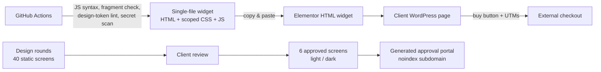

# Investor Academy Storefront — Case Study

> A product storefront embedded in a newspaper's WordPress site, plus the full UI design for its upcoming subscription platform, built for the investor-education arm of a major Brazilian news publisher.
> **Source code is private.** This repository documents the project; a live walkthrough is available on request.

## The problem
The academy sold courses, recommended portfolios and newsletters, each on its own landing page. There was no single place to see and compare every product, and the client's WordPress theme and plugins could not be changed. Next, the academy wanted a subscription platform (storefront, member area, course player and admin), and needed approved screens before any development started.

## What I built
- **Storefront widget (in production)** — one self-contained HTML fragment pasted into an Elementor HTML widget: product grid, comparison, authority block, FAQ and legal footer.
- **Tracking-safe buy buttons** — every button builds its checkout link at runtime and carries the page's UTM parameters, so campaign attribution survives the click.
- **Theme-proof styling** — everything scoped under one root class with `:where()` resets, so the widget never fights the host theme and the theme never breaks the widget.
- **Platform UI design** — 40 static screens across three design rounds (storefront, login, member area, course page with lesson player, admin for products, users, plans and access windows), narrowed with the client to 6 approved screens.
- **Light and dark themes** — every approved screen switches theme in place, remembers the choice per page and applies it before first paint.
- **Approval portal** — a generated index with live, scaled previews of each screen, kept out of search engines (meta robots, `robots.txt` and `X-Robots-Tag`).

## Architecture

- **No build step, no framework:** the widget is plain HTML, CSS and JavaScript in one file, because the only deployment path was pasting into the client's page builder.
- **Design tokens in one place:** colors, type and radii live in a design spec and in CSS custom properties, and CI lints the spec on every push.
- **Motion respects the user:** animations run only through `IntersectionObserver` inside `prefers-reduced-motion: no-preference`, and content is never hidden if a script fails.
- **Accessibility as a gate:** text contrast of at least 4.5:1, visible focus, 44 px touch targets and no text under 11 px, checked at 320, 375, 768 and 1024 px.

## Scale
- 1 production widget of ~400 lines (HTML, CSS and JavaScript)
- 40 design screens in 3 rounds; the 6 approved screens total ~4.6k lines
- Status: storefront live; subscription platform in design (screens approved, development not started)

## My role
End to end: scoping with the client, UX and visual design of every screen, front-end implementation of the widget, accessibility and responsive QA, the CI checks, and publishing the widget to production. I coordinated AI coding agents for the layout rounds and reviewed and merged their work.

---
Built by **Victor Sestrem** · [LinkedIn](https://www.linkedin.com/in/victor-sestrem/) · victor-sestrem@hotmail.com
